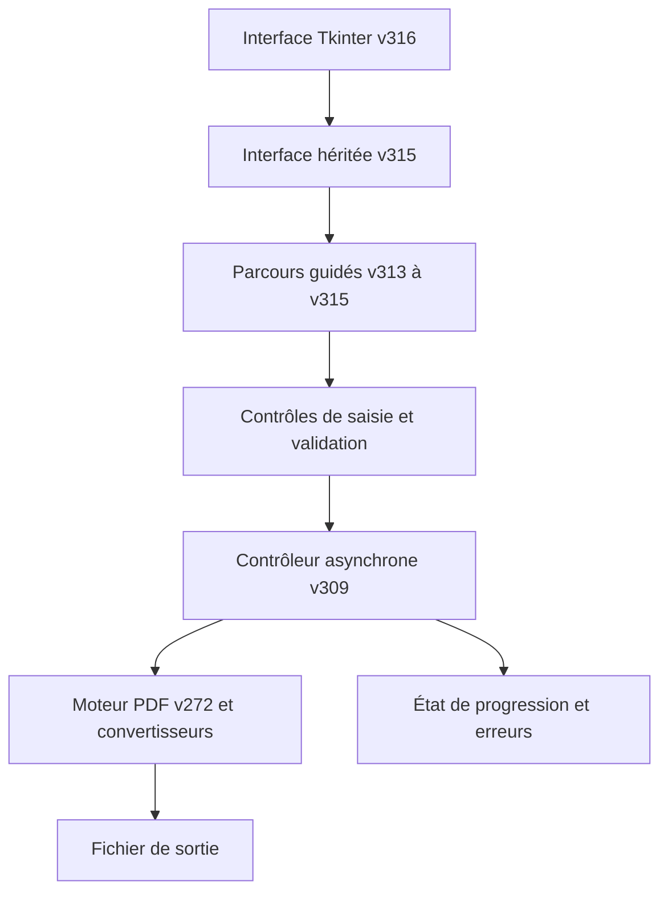
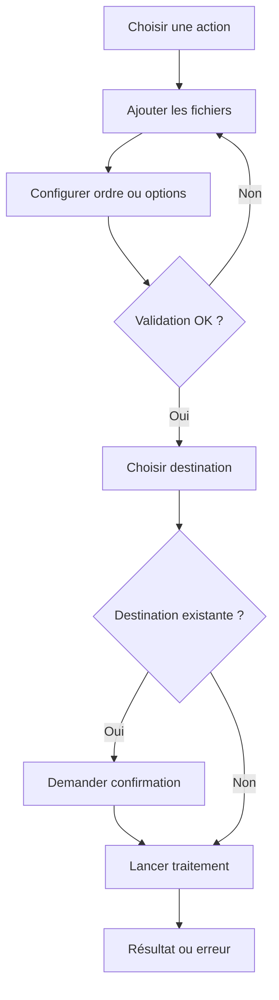

# Architecture OpenPDF Studio V31.6

Auteur : Abdelhalim Talbi

L'interface V31.6 hérite de V31.5. Aucun nouveau moteur PDF n'est introduit. Les contrôles sur la sortie et la prévention de remplacement de source sont assurés dans les parcours guidés existants.

## Organigramme d'utilisation

